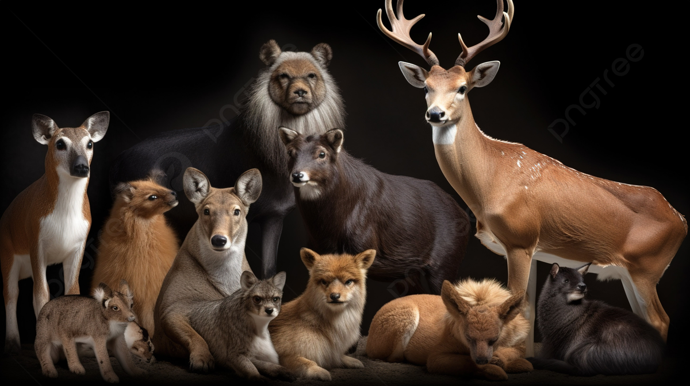

# Object Detection | اكتشاف الكائنات

مشروع لاكتشاف الكائنات في الصور باستخدام Python وOpenCV، بالاعتماد على نموذج SSD MobileNet V3 المدرب مسبقاً على مجموعة بيانات COCO.

A simple object detection project built with Python and OpenCV using the pre-trained SSD MobileNet V3 model and COCO dataset.

## نظرة عامة | Overview
يهدف المشروع إلى اكتشاف الكائنات الموجودة داخل الصور والتعرف عليها، مع تحديد مواقعها باستخدام إطارات تحيط بالكائنات المكتشفة (Bounding Boxes)، وإظهار أسماء الكائنات.

The project detects and identifies objects in images, displaying their names and locations using bounding boxes.

## التقنيات المستخدمة | Technologies

- Python
- OpenCV
- SSD MobileNet V3
- COCO Dataset

## هيكلية المشروع | Project Structure

text
Object-Detection/
├── cod/
│   ├── cod.py
│   └── ex.py
├── img/
│   ├── img4.jpg
│   └── img detection things.png
├── pages/
│   ├── frozen_inference_graph.pb
│   ├── nameThengs.names
│   └── ssd_mobilenet_v3_large_coco_2020_01_14.pbtxt
├── presentation/
│   └── Project_Presentation.pptx
└── README.md

## صور المشروع | Screenshots

### الصورة الأصلية | Input Image

الصورة قبل تنفيذ عملية اكتشاف الكائنات.

### نتيجة الاكتشاف | Detection Result

الصورة بعد اكتشاف الكائنات وتحديد مواقعها وإظهار أسمائها.

## طريقة العمل | How It Works
1. تحميل الصورة باستخدام OpenCV.
2. تحميل نموذج SSD MobileNet V3.
3. معالجة الصورة وتجهيزها للكشف.
4. اكتشاف الكائنات ومقارنتها بفئات COCO.
5. عرض النتائج مع أسماء الكائنات وإطارات تحديد المواقع.

## التثبيت والتشغيل | Installation & Run

تثبيت مكتبة OpenCV:
bash
pip install opencv-python

تشغيل المشروع:
bash
python cod/cod.py
تأكد من وجود ملفات النموذج والصورة في المسارات الصحيحة قبل التشغيل.

## العرض التقديمي | Project Presentation
يمكن الاطلاع على تفاصيل المشروع وطريقة عمله من خلال العرض التقديمي:
[View Project Presentation](presentation/Project_Presentation.pptx)

## المطور | Developer
**Ahmed Ali Aldhmshi**

Computer Science Graduate | Junior Developer